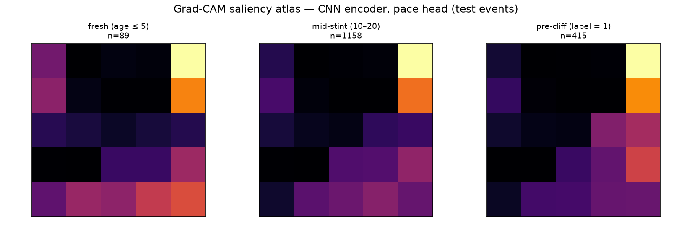

# Saliency Atlas (spec §2.6)

Grad-CAM on the CNN encoder (pace head), held-out test events, averaged per group.
NB: the §2.5 study found this model loses to persistence — the atlas explains a
weak model's attention, it is not evidence the textures are predictive.

```
                group    n  I_energy  II_dynamics  III_driver  IV_context
      fresh (age ≤ 5)   89     0.122        0.290       0.114       0.284
    mid-stint (10–20) 1158     0.078        0.354       0.072       0.269
pre-cliff (label = 1)  415     0.055        0.346       0.053       0.279
```

**Hypothesis** (attention shifts toward Quadrant I / Energy pre-cliff): **NOT SUPPORTED** — Quadrant I share 12.2% (fresh) → 5.5% (pre-cliff).


