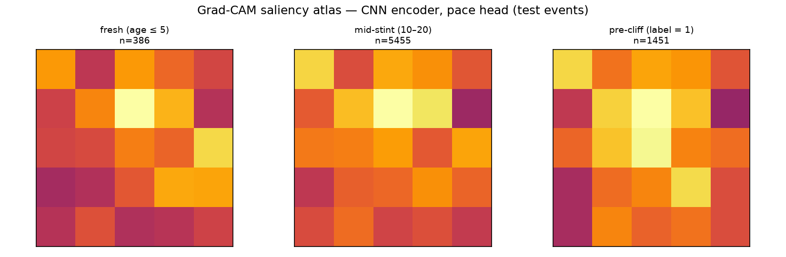

# Saliency Atlas (spec §2.6)

Grad-CAM on the CNN encoder (pace head), held-out test events, averaged per group.
NB: the §2.5 study found this model loses to persistence — the atlas explains a
weak model's attention, it is not evidence the textures are predictive.

```
                group    n  I_energy  II_dynamics  III_driver  IV_context
      fresh (age ≤ 5)  386     0.160        0.158       0.125       0.165
    mid-stint (10–20) 5455     0.171        0.158       0.140       0.146
pre-cliff (label = 1) 1451     0.168        0.149       0.130       0.156
```

**Hypothesis** (attention shifts toward Quadrant I / Energy pre-cliff): **NOT SUPPORTED (pre-cliff exceeds earlier groups by -0.3%, threshold 2%)** — Quadrant I share 16.0% (fresh) → 17.1% (mid-stint) → 16.8% (pre-cliff).


